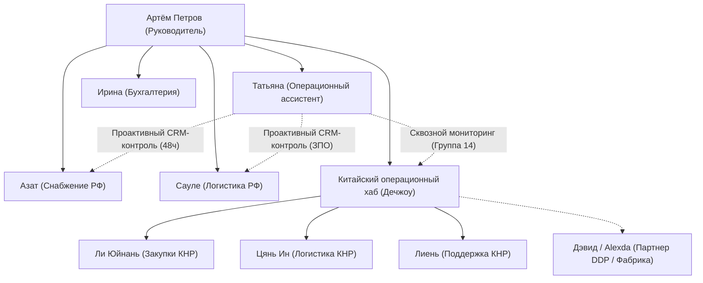

# Проект HR: Управление персоналом, оргструктура и адаптация

Единый навигатор и диспетчер кадровых процессов, онбординга и операционного контроля ГК «Лун-Ван» / «Ци Линь».

---

## 🏛️ 1. Архитектура и структура направлений

---

## 📁 2. Навигатор по подпроектам и ключевым документам

### А. Действующий операционный ассистент: [Татьяна](file:///C:/Codex_Personal/projects/HR/Татьяна)
* **Канонический реестр задач:** [tasks_registry_tatyana.md](file:///C:/Codex_Personal/projects/HR/Татьяна/tasks_registry_tatyana.md) (82 задачи).
* **Интерактивная Excel-витрина с автофильтрами:** [tasks_registry_tatyana.xlsx](file:///C:/Codex_Personal/projects/HR/Татьяна/tasks_registry_tatyana.xlsx).
* **Базовый регламент входа и анти-ошибки:** [Шпаргалка_Операционного_Ассистента.md](file:///C:/Codex_Personal/projects/HR/Татьяна/Шпаргалка_Операционного_Ассистента.md).
* **Ключевой инвариант 1-го месяца:** Полная изоляция от 1С:УНФ; работа строго в Битрикс24 + DeepSeek. Фокус на задачах №79–82 (контроль брокера, Азата, ЗПО и китайского хаба).

### Б. Международный контур: [Китайский снабженец](file:///C:/Codex_Personal/projects/HR/Китайский%20снабженец)
* **Регламент найма, мотивации и KPI:** [HR_CHINA_POLICY.md](file:///C:/Codex_Personal/projects/HR/Китайский%20снабженец/HR_CHINA_POLICY.md) (5000 RMB + 10% возврата 退税 + 1% GMV $\times K_{\text{orders}}$).
* **Корпоративный кодекс закупщика:** [CHARTER_SUPPLY_LONGWANG.md](file:///C:/Codex_Personal/projects/HR/Китайский%20снабженец/CHARTER_SUPPLY_LONGWANG.md) («Устав снабженца Лун-Ван»).
* **Двуязычный регламент CRM (RU/CN):** [ИНСТРУКЦИЯ_ПО_РАБОТЕ_В_БИТРИКС24_ДЛЯ_КИТАЙСКОГО_ОФИСА.md](file:///C:/Codex_Personal/projects/HR/Китайский%20снабженец/ИНСТРУКЦИЯ_ПО_РАБОТЕ_В_БИТРИКС24_ДЛЯ_КИТАЙСКОГО_ОФИСА.md).
* **Индивидуальные спринты сотрудников:**
  - Ли Юйнань (закупки): [Вводный_инструктаж_и_спринт_Ли_Юйнань_Снабжение.md](file:///C:/Codex_Personal/projects/HR/Китайский%20снабженец/Вводный_инструктаж_и_спринт_Ли_Юйнань_Снабжение.md)
  - Цянь Ин (логистика): [Вводный_инструктаж_и_спринт_Цянь_Ин_Логистика.md](file:///C:/Codex_Personal/projects/HR/Китайский%20снабженец/Вводный_инструктаж_и_спринт_Цянь_Ин_Логистика.md)
  - Лиень (поддержка): [Вводный_инструктаж_и_спринт_Лиень_Поддержка_и_Логистика.md](file:///C:/Codex_Personal/projects/HR/Китайский%20снабженец/Вводный_инструктаж_и_спринт_Лиень_Поддержка_и_Логистика.md)
* **Партнерская модель и DDP:** [EQUIPMENT_AND_DDP_PARTNERSHIP_MODEL.md](file:///C:/Codex_Personal/projects/HR/Китайский%20снабженец/EQUIPMENT_AND_DDP_PARTNERSHIP_MODEL.md).

### В. Архивный обучающий кейс: [Чулпан Хузина](file:///C:/Codex_Personal/projects/HR/Чулпан%20Хузина)
* **Детальный аудит выполнения задач с пруфами:** [tasks_audit.md](file:///C:/Codex_Personal/projects/HR/Чулпан%20Хузина/tasks_audit.md).
* **Итоги испытательного срока:** [progress.md](file:///C:/Codex_Personal/projects/HR/Чулпан%20Хузина/progress.md).
* **Методичка «Как не надо делать»:** [human_face_history.md](file:///C:/Codex_Personal/projects/HR/Чулпан%20Хузина/human_face_history.md) (уроки по пассивному наблюдению, Excel-бюрократии и саботажу Базы знаний).

---

## ⚙️ 3. Скрипты и автоматизация HR

* `build_candidates_rag_db.py` — индексация резюме кандидатов в RAG-базу.
* `create_candidates_excel.py` — генерация аналитических таблиц по пулу соискателей.
* `check_inbox_reply.py` — проверка входящих откликов кандидатов по почтовым протоколам.
