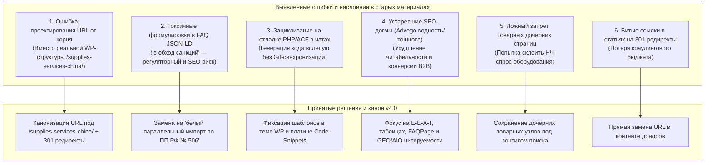

# Сводный Аудит Расхождений, Неактуальных Решений и Дорожная Карта (Roadmap P0/P1/P2)

> [!IMPORTANT]
> Документ представляет собой критический разбор наработок по SEO проекту **Longwang.ru**: сопоставление данных чатов ChatGPT, наработок Gemini, мастер-документов, отчетов Screaming Frog (GoW Project) и **результатов live-проверки сервера от 12 октября 2026 года**.

---

## 1. Что мы считаем неактуальным, ошибочным или токсичным в имеющихся материалах

В ходе многомесячных итераций в чатах накопился пласт наслоений, ложных гипотез и технически ошибочных суждений. Ниже приведен их детальный реестр:

### 1.1. Ошибка URL-адресации: Проектирование от корня вместо вложенности
- **В чем ошибка:** В десятках промптов и матриц фигурировали адреса вроде `https://longwang.ru/equipment-from-china/`, `https://longwang.ru/autsorsing-ved/`, `https://longwang.ru/poisk-postavshchikov-v-kitae/`.
- **Фактическое состояние:** На боевом сервере WordPress страницы живут внутри родительского раздела `/supplies-services-china/`, а транслитерация поиска фабрик звучит как `/poisk-i-podbor-postavshika/`.
- **Последствия:** При переходе по старым ссылкам пользователь и поисковые боты получали `404 Not Found` (подтверждено live-проверкой: 16 корневых URL отдали 404!).
- **Вердикт:** Все ссылки, матрицы и промпты переведены на реальные Live-URL. На сервере необходимо настроить 301-редиректы со старых корней.

### 1.2. Токсичные формулировки в микроразметке FAQPage JSON-LD
- **В чем ошибка:** В файле `миним задача.docx` зафиксировано наличие фразы *«в обход санкций»* в разметке FAQ на главной странице.
- **Риск:** Критический регуляторный риск. Яндекс и Google фильтруют подобные сниппеты, рекламные кабинеты отклоняют домен, а финансовые шлюзы в Китае (VTB Shanghai, Bank of Kunlun) при комплаенс-проверке сайта отклоняют платежи.
- **Вердикт:** Строжайший запрет любых упоминаний «обхода санкций». Использовать строго: *«параллельный импорт оригинальной продукции в соответствии с ПП РФ № 506»*, *«поставки промышленного оборудования и автоматики от лицензированных производителей»*.

### 1.3. Зацикливание на отладке PHP/ACF шаблонов в диалогах
- **В чем ошибка:** В отчете ChatGPT зафиксированы сотни сообщений с попытками «на лету» переписать PHP-шаблоны WordPress, угадывая названия полей `get_field('equipment_models')`, имена классов и структуру ACF.
- **Вердикт:** SEO-чат не должен быть местом слепого перебора PHP-кода. Финальный код шаблона термооборудования должен быть зафиксирован в теме оформления, а имена полей синхронизированы через экспорт JSON из Advanced Custom Fields.

### 1.4. Устаревшие механические метрики «водности» и «тошноты»
- **В чем ошибка:** Требования вида «водность строго <15%, тошнота строго <15%, text/html >25%» в B2B-сегменте вредны, если соблюдаются механически. Текст становится телеграфным, лишенным деловой убедительности.
- **Вердикт:** В 2026 году ключевой фактор ранжирования — **E-E-A-T и GEO/AIO (пригодность для ИИ-поиска)**: точные технические характеристики в таблицах, логика этапов, кейсы с цифрами, реквизиты, лицензии и прозрачные гарантии.

### 1.5. Попытки объединить поиск оборудования и поиск поставщиков
- **В чем ошибка:** В ранних заметках модель предлагала склеить эти направления, опасаясь каннибализации.
- **Вердикт:** Артем абсолютно верно пресек это. Поиск оборудования (станков, печей, линий) — это сложная инженерная закупка с ТЗ и пусконаладкой. Поиск поставщиков товаров — это подбор фабрик для серийного ширпотреба. Интенты принципиально разные.

---

## 2. Результаты Live-Сверки с сервером (Срез от 12.10.2026)

Скрипт `scripts/verify_live_urls.py` выполнил тестовый опрос боевого сервера:

| URL | Код ответа сервера | Пояснение и статус |
|---|---|---|
| `https://longwang.ru/` | `200 OK` | Главная страница доступна, title и canonical корректны. |
| `https://longwang.ru/supplies-services-china/` | `200 OK` | Хаб услуг доступен, карта направлений работает. |
| `https://longwang.ru/equipment-from-china/` | `301 Moved Permanently` | Корректно перенаправляет на `/supplies-services-china/equipment-from-china/`. |
| `https://longwang.ru/ved-s-kitaem/` | `301 Moved Permanently` | Корректно перенаправляет на `/supplies-services-china/autsorsing-ved/ved-s-kitaem/`. |
| `https://longwang.ru/projects/` | `200 OK` | Раздел B2B кейсов доступен, открыт к индексации. |
| `https://longwang.ru/useful-articles/` | `200 OK` | Блог доступен, title и canonical в норме. |
| `.../useful-articles/kak-kupit-oborudovanie-kitay/` | `200 OK` | Статья-гайд доступна, canonical в норме. |
| `https://longwang.ru/?pagespeed=1` | `410 Gone` | **ПРАВИЛО РАБОТАЕТ!** Мусорный URL корректно удален из индекса. |
| `https://longwang.ru/test%2C` | `410 Gone` | **ПРАВИЛО РАБОТАЕТ!** Запросы с запятой получают 410. |
| `https://longwang.ru/?__mjo=1` | `410 Gone` | **ПРАВИЛО РАБОТАЕТ!** Запросы с `__mjo` получают 410. |
| Корневые адреса услуг (`/poisk-postavshchikov-v-kitae/`, `/dostavka-gruzov-iz-kitaya/` и др.) | `404 Not Found` | ⚠️ **ТРЕБУЕТ ДОРАБОТКИ:** настроить 301 редиректы на соответствующие страницы внутри `/supplies-services-china/`. |

---

## 3. Матрица Приоритетов Внедрения (Roadmap P0 / P1 / P2)

### 🔴 P0: Блокирующие задачи (Безопасность, 404-ошибки, Ссылочные дыры)
1. **Санитарная зачистка текста и разметки FAQPage JSON-LD:**
   - Проверить код главной страницы `main___longwang.ru_new.html` и базу данных WordPress.
   - Исключить любые вхождения «в обход санкций». Заменить на официальный термин «параллельный импорт по ПП РФ № 506».
2. **Исправление внутренних ссылок на 301-редиректы в Блоге (Redirect Fixes):**
   - Заменить 6 ссылок в статьях (например, в `stoimost-dostavki-iz-kitaya/` и новостях) с адресов `kak-dostavit-gruz-iz-kitaya-samoletom/` на прямой канонический адрес `aviadostavka-gruzov-iz-kitaya/`.
3. **Настройка 301-редиректов со старых корневых URL на хабовые:**
   - Настроить в плагине Redirection или `.htaccess` правила перенаправления:
     - `/poisk-postavshchikov-v-kitae/` → `/supplies-services-china/poisk-i-podbor-postavshika/`
     - `/dostavka-gruzov-iz-kitaya/` → `/supplies-services-china/dostavka-is-kitaya/`
     - `/tamozhennoe-oformlenie-gruzov-iz-kitaya/` → `/supplies-services-china/dostavka-is-kitaya/tamojennoe-oformlenie-china/`
4. **Устранение изоляции дочерних страниц печей:**
   - Разместить на родительской странице `/equipment-from-china/` блок со ссылками на 10 дочерних типов печей (муфельные, вакуумные, трубчатые и др.), устранив дефицит входящего веса.

---

### 🟡 P1: Архитектурное усиление и конверсионная оптимизация
5. **Стабилизация шаблона термооборудования (`thermo-equipment-china`):**
   - Закрепить рабочий набор полей ACF (hero, advantages, models, specs, faq).
   - Убедиться, что блок FAQ выводится и размечается `FAQPage` без ошибок.
6. **Реализация приоритетных перелинковок из Блога на Хабы (Opportunities):**
   - Отобрать топ-50 статей с наибольшим органическим трафиком.
   - Проставить контекстные ссылки на хаб Оборудования, хаб Доставки и хаб ВЭД по правилам анкорного листа.
7. **Проверка страниц брендов параллельного импорта:**
   - Проверить индексацию брендовых страниц (Bitzer, Atlas Copco, Cummins, Sany) и наличие ссылок на хаб параллельного импорта.

---

### 🟢 P2: Контентное масштабирование и E-E-A-T
8. **Запуск конвейера B2B-кейсов в `/projects/`:**
   - Генерация и публикация кейсов по стандарту v2.0/v5.0 с реальными цифрами, марками оборудования и логистическими цепочками.
9. **Оптимизация под генеративный ИИ-поиск (GEO / AIO):**
   - Внедрение структурированных таблиц и Q&A блоков в экспертные статьи блога для цитирования в Яндекс Нейро и Google AI Overviews.
10. **Регулярный мониторинг краулера Screaming Frog:**
    - Повторный прогон краулера раз в месяц для отслеживания битых ссылок и дублей страниц.
