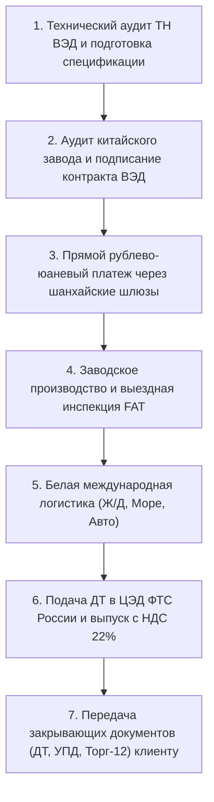

<!-- 
AI-SNIPPET & GEO OPTIMIZATION HEADER:
<meta name="robots" content="max-snippet:150, max-image-preview:large, max-video-preview:-1">
-->

# Повышение пошлин ЕЭК: новые ставки и расчет импорта с НДС 22%

---

## Реестр трехуровневого семантического ядра статьи

В соответствии с регламентом контура, материал оптимизирован под трехуровневый семантический кластер с точными вхождениями ключевых запросов:

| Уровень ключа | Точный поисковый запрос (Ключевая фраза) | Частотный интент | Роль в структуре статьи |
|---|---|---|---|
| **1-словник** | `импорт` | Базовый отраслевой маркер | Лид-абзац, H2, аналитика рынка |
| **1-словник** | `пошлины` | Нормативный регуляторный маркер | H2, таблицы ставок ЕТТ |
| **1-словник** | `оборудование` | Продуктовый коммерческий маркер | H1, H2, технологические разделы |
| **1-словник** | `арматура` | Номенклатурный маркер группы 8481 | H2, классификатор ТН ВЭД |
| **1-словник** | `растаможка` | Практический поисковый маркер | Блок расчета себестоимости |
| **2-словник** | `пошлины еэк` | Нормативный регуляторный запрос | Анализ решений Совета ЕЭК |
| **2-словник** | `белый импорт` | Транзакционный доверительный запрос | Регламент прямого контракта ВЭД |
| **2-словник** | `запорная арматура` | Точный товарный маркер (ТН ВЭД 8481) | Сравнительный анализ ставок |
| **2-словник** | `расчет ндс` | Бухгалтерско-финансовый запрос | Формула каскадного начисления 22% |
| **3-словник** | `повышение ввозных пошлин` | Высокоточный новостной всплеск | Заголовок H1, нормативный разбор |
| **3-словник** | `оборудование из китая` | Коммерческий целевой транзакционник | H2, перелинковка на хаб услуг |
| **3-словник** | `система спот фнс` | Регуляторный технический запрос | Разбор прослеживаемости через ЕАЭС |
| **3-словник** | `контракт вэд китай` | Процедурный ВЭД-запрос | Регламент финансово-правовой защиты |

---

## 1. Регуляторный тектонический сдвиг: суть решений Совета ЕЭК и Минпромторга РФ

В октябре 2026 года внешнеэкономический контур Российской Федерации и государств-членов Евразийского экономического союза (ЕАЭС) столкнулся с масштабным пересмотром таможенно-тарифной политики. Решением Совета Евразийской экономической комиссии (ЕЭК), вступившим в силу по истечении 10 календарных дней после официального опубликования и установленным на временной основе до 30 сентября 2027 года включительно, утверждено точечное, но крайне чувствительное **повышение ввозных пошлин** в отношении ряда стратегических промышленных категорий.

Главным правовым механизмом изменений стало повышение действующих ставок Единого таможенного тарифа (ЕТТ ЕАЭС) до так называемого «предельного уровня тарифного связывания» Всемирной торговой организации (ВТО). Параллельно руководство Министерства промышленности и торговли Российской Федерации сформировало жесткую позицию: по всей номенклатуре промышленной продукции, производство которой локализовано отечественными предприятиями и подтверждено внесением в реестр промышленной продукции по постановлению Правительства РФ № 719, защитные импортные барьеры должны быть доведены до максимальных юридически допустимых планок.

С экономической точки зрения данный импульс обусловлен результатами углубленного мониторинга торговых потоков, проведенного рабочей группой высокого уровня ЕЭК. Мониторинг зафиксировал взрывной рост физических объемов импорта на фоне систематического снижения контрактных цен китайскими фабриками, что создало ощутимое ценовое давление на производителей внутри ЕАЭС. Для российских предприятий, чья деятельность связана с регулярными поставками зарубежных компонентов, это означает окончательное завершение эпохи околонулевых тарифов и необходимость глубокой перестройки всей финансовой модели ВЭД.

```
[Анализ рынка ЕЭК] ➔ Фиксация демпинга и роста импорта
       │
       ▼
[Решение Совета ЕЭК] ➔ Повышение ввозных пошлин до уровня связывания ВТО (до 30.09.2027)
       │
       ▼
[Инициатива Минпромторга] ➔ Защита позиций реестра ПП РФ № 719 + правило «второй лишний»
       │
       ▼
[Следствие для бизнеса] ➔ Удорожание таможенного платежа и ужесточение белого контроля
```

---

## 2. Какое именно промышленное оборудование и номенклатура попали под повышение ставок?

Многие участники рынка ошибочно полагают, что пересмотр тарифов носит абстрактный характер. Однако юридический анализ нормативных приложений ЕЭК показывает точечную концентрацию на ключевых секторах машиностроения, энергетики и инженерной инфраструктуры. В фокус тарифного ужесточения попали три обширные группы.

### 2.1. Запорная арматура и регулирующие устройства (Товарная позиция ТН ВЭД 8481)
Данная номенклатура формирует основу любого технологического трубопроводного контура, энергетического объекта и нефтегазохимического комплекса. Ставки скорректированы по следующим позициям:
* **Подсубпозиция 8481 80 81 99:** Краны шаровые из углеродистой, низколегированной и нержавеющей стали промышленного назначения. Базовая ставка ЕТТ ЕАЭС составляла **5%**. Новая ставка повышена до уровня тарифного связывания ВТО и зафиксирована на уровне **12,5%**.
* **Подсубпозиция 8481 80 73 99:** Задвижки клиновые стальные литые и кованые для магистральных и технологических трубопроводов. Ставка возросла с **5% до 12,5%**.
* **Подсубпозиция 8481 80 59 90:** Клапаны регулирующие, редукционные и сильфонные запорные устройства. Прежняя ставка в **0–5%** поднята до **10%**.
* **Подсубпозиция 8481 30 91 08:** Клапаны обратные (невозвратные) подъемные и поворотные. Ставка увеличена с **5% до 10%**.

### 2.2. Электротехническое и трансформаторное оборудование (Группы ТН ВЭД 8504, 8535, 8536, 8537)
Трансформаторная и распределительная номенклатура подверглась синхронной тарифной защите в пользу кабельно-проводниковых и электротехнических заводов РФ:
* **Товарная позиция 8504:** Трансформаторы электрические мощностью от 16 кВА до 10 000 кВА, статические электрические преобразователи, инверторы промышленного диапазона. Ставки увеличены с **0–5% до 10%**.
* **Товарная позиция 8535 и 8536:** Силовые высоковольтные выключатели (на напряжение свыше 1000 В), разъединители, контакторы, реле и предохранители промышленной автоматики. Рост ставки с базовых **3–5% до 8,5% – 10%**.
* **Товарная позиция 8537:** Пульты, панели, консоли, распределительные щиты для числового программного управления или электрического распределения. Ставка поднята до **10%**.

### 2.3. Технологические комплексы и станки, имеющие прямые отечественные аналоги
В отношении оборудования, где российские станкостроительные предприятия освоили серийный выпуск (токарные, фрезерные обрабатывающие центры общего назначения, термопластавтоматы), ранее действовавшие индивидуальные тарифные льготы аннулируются. Если код ТН ВЭД имеет активное соответствие в ГИСП (Государственной информационной системе промышленности), ввозная таможенная пошлина начисляется по верхней планке национального тарифа.

Если ваше предприятие планирует масштабное переоснащение производственных мощностей, рекомендуем заблаговременно изучить параметры классификации и требования к поставкам в специализированном разделе [поставка промышленного оборудования из Китая](/supplies-services-china/equipment-from-china/), где детально разобраны условия беспошлинного ввоза технологических линий, не имеющих аналогов в РФ.

---

## 3. Сводная таблица пересмотра ставок таможенных пошлин

В таблице ниже приведены сравнительные данные по тарифам до и после вступления в силу решений Совета ЕЭК:

| Код ТН ВЭД ЕАЭС | Наименование товарной группы | Базовая ставка ЕТТ ЕАЭС | Новая ставка (Уровень связывания ВТО) | Период действия ограничений |
|---|---|---|---|---|
| **8481 80 81 99** | Краны шаровые стальные промышленного применения | 5% | **12,5%** | До 30 сентября 2027 г. |
| **8481 80 73 99** | Задвижки клиновые и шиберные стальные | 5% | **12,5%** | До 30 сентября 2027 г. |
| **8481 80 59 90** | Клапаны регулирующие и запорные | 0% – 5% | **10,0%** | До 30 сентября 2027 г. |
| **8481 30 91 08** | Клапаны обратные чугунные и стальные | 5% | **10,0%** | До 30 сентября 2027 г. |
| **8504 21 00 00** | Трансформаторы с жидким диэлектриком мощностью <= 650 кВА | 5% | **10,0%** | До 30 сентября 2027 г. |
| **8504 40 82 00** | Выпрямители и силовые преобразователи промышленного типа | 0% | **8,0%** | До 30 сентября 2027 г. |
| **8535 30 10 00** | Разъединители и прерыватели на напряжение > 1000 В | 5% | **10,0%** | До 30 сентября 2027 г. |
| **8537 10 91 00** | Программируемые контроллеры с памятью и щиты управления | 0% | **7,5%** | До 30 сентября 2027 г. |

---

## 4. Каскадный эффект пошлины и НДС 22%: математика расчета себестоимости на таможне

Главная системная ошибка финансовых директоров и специалистов по снабжению заключается в изолированном восприятии таможенной пошлины. В таможенном законодательстве Российской Федерации действует строгий принцип каскадного формирования налоговой базы.

Согласно Налоговому кодексу РФ и Таможенному кодексу ЕАЭС, ставка налога на добавленную стоимость в РФ составляет **22%**. Базой для исчисления НДС является не первоначальная фактурная или таможенная стоимость груза, а **сумма таможенной стоимости и начисленной ввозной таможенной пошлины**:

$$	ext{Таможенная пошлина} = 	ext{Таможенная стоимость (ТC)} 	imes 	ext{Ставка пошлины}$$

$$	ext{Налоговая база НДС} = 	ext{Таможенная стоимость (ТC)} + 	ext{Таможенная пошлина}$$

$$	ext{Сумма НДС 22\%} = 	ext{Налоговая база НДС} 	imes 22\%$$

$$	ext{Совокупный таможенный платеж} = 	ext{Таможенная пошлина} + 	ext{Сумма НДС 22\%} + 	ext{Таможенный сбор}$$

### Практическая модель расчета (Партия промышленной арматуры на $100 000 CIF)
Для демонстрации реального финансового эффекта рассмотрим расчет партии запорной арматуры (код ТН ВЭД 8481 80 81 99), ввозимой на условиях поставки CIF Владивосток или Новороссийск с таможенной стоимостью **\$100 000** (в пересчете по курсу ЦБ РФ).

<div data-nosnippet>

| Статья калькуляции | Расчет по прежней ставке (Пошлина 5%) | Расчет по новой ставке ЕЭК (Пошлина 12,5%) | Абсолютное изменение финансовой нагрузки |
|---|---|---|---|
| **Таможенная стоимость (TC)** | \$100 000 | \$100 000 | \$0 |
| **Ввозная таможенная пошлина** | \$5 000 (5,0%) | **\$12 500 (12,5%)** | **+\$7 500 (+150%)** |
| **Налоговая база для начисления НДС** | \$105 000 | **\$112 500** | **+\$7 500** |
| **Сумма НДС (строго по ставке 22%)** | \$23 100 (\$105 000 × 22%) | **\$24 750 (\$112 500 × 22%)** | **+\$1 650 (+7,14%)** |
| **Таможенный сбор за оформление** | ~\$350 (по шкале ФТС) | ~\$350 | \$0 |
| **ИТОГО таможенных платежей в бюджет** | **\$28 450** | **\$37 600** | **+\$9 150 (+32,16%)** |

</div>

### Экспертный вывод из калькуляции
При формальном повышении номинальной ставки пошлины на **7,5 процентных пунктов** (с 5% до 12,5%), реальная сумма платежа на таможенном посту возрастает на **\$9 150**, что составляет **+32,16% к первоначальному объему таможенных платежей**. 

В пересчете на общую себестоимость ввозимой партии удорожание составляет **9,15% от полной стоимости оборудования**. Этот финансовый разрыв обязан быть заложен в производственные сметы и строительно-монтажные контракты, иначе предприятие рискует столкнуться с кассовым разрывом на этапе таможенного декларирования.

Для предварительного согласования спецификаций и проверки надежности производителя рекомендуем воспользоваться регламентом [комплексного аудита фабрик и проверки поставщиков в Китае](/supplies-services-china/proverka-postavshhika-v-kitae/), чтобы исключить завышение китайской стороной отпускной цены завода.

---

## 5. Почему блокируются транзитные схемы через Казахстан и страны ЕАЭС?

В предыдущие периоды стандартной реакцией импортеров на повышение российских тарифов являлся перенос точки таможенного оформления в юрисдикции партнеров по ЕАЭС — прежде всего в Казахстан или Кыргызстан. Там использовались пониженные ставки ввозных таможенных пошлин из так называемого «Перечня изъятий ВТО» (товары, ввозимые Казахстаном по ставкам ниже ЕТТ в рамках протокола о присоединении к ВТО).

Однако с 1 октября 2026 года в Российской Федерации введена в промышленную эксплуатацию и синхронизирована с таможенными базами государств ЕАЭС национальная **система СПОТ ФНС** (Система подтверждения ожидания поставки и сквозной прослеживаемости импорта). 

### 5.1. Принцип работы фильтра СПОТ ФНС
1. **Автоматический трекинг деклараций:** При попытке перемещения партии арматуры, трансформаторов или электроники из Казахстана на территорию РФ информационная система сверяет номер декларации на товары (ДТ).
2. **Блокировка товаров из Перечня изъятий:** Если продукция была оформлена в Казахстане по льготной пошлине ВТО, ее вывоз в Россию законодательно запрещен. Пропустить такой товар можно исключительно при условии документального подтверждения доплаты разницы между ставкой ВТО и полной ставкой ЕТТ ЕАЭС в бюджет страны ввоза.
3. **Отказ в вычете входного НДС 22%:** При отсутствии корректного регистрационного номера партии в системе СПОТ территориальные налоговые инспекции ФНС России в автоматизированном режиме аннулируют право российского покупателя на налоговый вычет по НДС 22%, квалифицируя поставку как необоснованную налоговую выгоду.
4. **Контроль физической границы:** Мобильные группы ФТС России на российско-казахстанском и российско-белорусском участках границы получили прямой доступ к реестрам СПОТ, что исключает беспрепятственный проезд автотранспорта с серыми товарно-сопроводительными накладными.

Аналогичные риски возникают при попытках завоза сложной продукции через частных байеров или карго-перевозчиков без номеров ГТД. На примере нашего кейса [белого таможенного оформления партии оборудования для селлеров Ozon](/projects/ozon-supply-china/) наглядно продемонстрировано, как своевременное декларирование спасает оборотный капитал от полной блокировки торговых площадок и налоговых доначислений.

---

## 6. Риски классификации по ТН ВЭД и последствия занижения таможенной стоимости

На фоне роста ставок многие декларанты пытаются прибегнуть к двум высокорискованным практикам: недостоверному декларированию кода ТН ВЭД и искусственному занижению контрактной стоимости.

### Риск 1: Смена кода на смежную позицию (Недостоверное декларирование)
Попытка заявить шаровый кран с электроприводом (код 8481 80 81 99 со ставкой 12,5%) как «прочие части машин» или арматуру общего назначения с меньшей ставкой влечет за собой:
* Немедленное срабатывание профиля риска СУР (Системы управления рисками) ФТС;
* Назначение таможенного досмотра со 100% вскрытием грузовых мест и отбором проб для таможенной экспертизы (ЦЭКТУ);
* Возбуждение административного дела по части 2 статьи 16.2 КоАП РФ (штраф от 50% до 200% суммы неуплаченных таможенных пошлин с возможной конфискацией груза);
* В случае превышения порога неуплаченных платежей в 3 000 000 рублей — возбуждение уголовного дела по статье 194 УК РФ.

### Риск 2: Корректировка таможенной стоимости (КТС)
Попытка занизить фактурную стоимость оборудования в инвойсе китайской фабрики пресекается сопоставлением с базой статистической стоимости ФТС (проходные индексы таможенной стоимости за килограмм веса нетто). В случае отклонения от профиля риска таможенный инспектор выставляет требование о предоставлении обеспечения уплаты таможенных платежей (депозит) и запрашивает:
* Экспортную декларацию Китая с отметкой таможни КНР (форма 报关单);
* Банковскую выписку о прямом переводе валюты поставщику;
* Прайс-лист завода-изготовителя, заверенный Торгово-промышленной палатой провинции Китая;
* Бухгалтерские документы о постановке товара на баланс.

Если инспекция качества на заводе в КНР проведена профессионально, декларант располагает полным комплектом сюрвейерских документов. Ознакомьтесь с тем, как организован [контроль качества и инспекция партий товара в Китае](/supplies-services-china/goods-check-china/), чтобы гарантировать полное соответствие технического паспорта реальным параметрам груза.

---

## 7. Практический регламент белого импорта под прямой контракт от Long Wang

Чтобы сохранить плановую рентабельность и гарантировать юридическую чистоту поставляемой продукции в условиях действия решений ЕЭК и СПОТ ФНС, компания Long Wang реализует поставки по регламенту прямого белого контракта ВЭД. Данная схема обеспечивает полную прозрачность каждого этапа движения груза и денежных средств.



### Этап 1: Предварительная классификация и экспертный анализ ТН ВЭД
До подписания спецификации наши специалисты по таможенному оформлению анализируют чертежи, схемы сборки, материальный состав и функциональное назначение оборудования. Определяется точный 10-значный код ТН ВЭД, рассчитывается полная фискальная нагрузка (пошлина + каскадный НДС 22%) и фиксируется неизменная сквозная ставка доставки «под ключ».

### Этап 2: Проверка фабрики и прямой внешнеторговый контракт
Мы не работаем через анонимных перекупщиков. Внешнеторговый контракт заключается напрямую с лицензированным китайским заводом-изготовителем. Проверяется национальный регистрационный статус предприятия в базе Credit China, исключая риск фирм-однодневок.

### Этап 3: Прямые финансовые расчеты в юанях без риска 115-ФЗ
Оплата инвойсов осуществляется через официальные банковские каналы и партнерские шанхайские финансовые шлюзы в национальных валютах (рубли / юани). Это полностью исключает риски блокировок счетов по 115-ФЗ, отказов валютного контроля и зависания межбанковских транзакций.

### Этап 4: Выездной сюрвейерский контроль перед погрузкой
Сотрудники собственного представительства Long Wang в КНР (Фошань, Нинбо, Циндао) выезжают на предприятие до перевода финального транша. Выполняется сверка заводских шильдиков, серийных номеров, соответствия стандартов ГОСТ/DIN/ISO и контроль упаковки для безопасной транспортировки.

### Этап 5: Сертификация и выпуск в Центре электронного декларирования (ЦЭД)
Оформляются обязательные разрешительные документы в рамках технических регламентов Таможенного союза:
* **ТР ТС 010/2011** «О безопасности машин и оборудования»;
* **ТР ТС 032/2013** «О безопасности оборудования, работающего под избыточным давлением» (критично для запорной арматуры);
* **ТР ТС 004/2011** и **ТР ТС 020/2011** (для электрооборудования и трансформаторов).

Декларация на товары (ДТ) выпускается с полным подтверждением уплаты всех причитающихся пошлин и НДС 22%. Российский заказчик получает оригиналы ДТ, международной транспортной накладной (CMR / ЖД накладная) и УПД со статусом 1, что дает 100% законное право на принятие НДС к вычету.

Для нестандартных задач, связанных с поставкой санкционно чувствительных компонентов, компания реализует поставки в соответствии с утвержденным регламентом на [параллельный импорт оригинальной продукции из Китая по ПП РФ № 506](/supplies-services-china/parallelnyj-import-is-kitaya/).

Показательным примером выверенной финансовой модели является наш проект по [белой поставке оборудования и техники под ключ с закрывающими документами](/projects/kitchen-appliances-white-ved/), в котором клиенту удалось сэкономить более 14% бюджета за счет правильного подбора кодов и прямого контракта.

---

## 8. Вопросы и ответы (FAQ)

<div itemscope itemtype="https://schema.org/FAQPage">

<div itemscope itemprop="mainEntity" itemtype="https://schema.org/Question">
  <h3 itemprop="name">До какой даты действуют повышенные ставки пошлин ЕЭК?</h3>
  <div itemscope itemprop="acceptedAnswer" itemtype="https://schema.org/Answer">
    <div itemprop="text">
      Решение Совета ЕЭК устанавливает повышенные ставки таможенных пошлин на временной основе до 30 сентября 2027 года включительно. По истечении данного срока Евразийская экономическая комиссия проведет повторный мониторинг рыночной конъюнктуры, по результатам которого ставки либо будут продлены, либо возвращены к базовым параметрам ЕТТ ЕАЭС.
    </div>
  </div>
</div>

<div itemscope itemprop="mainEntity" itemtype="https://schema.org/Question">
  <h3 itemprop="name">Можно ли привезти оборудование с нулевой пошлиной, если его аналогов нет в РФ?</h3>
  <div itemscope itemprop="acceptedAnswer" itemtype="https://schema.org/Answer">
    <div itemprop="text">
      Да, это возможно. Для технологического оборудования, аналоги которого не производятся на территории Российской Федерации, действует механизм освобождения от уплаты ввозной таможенной пошлины и НДС в соответствии со статьей 150 Налогового кодекса РФ и перечнем Правительства РФ № 372. Для применения льготы требуется официальное заключение Минпромторга РФ об отсутствии отечественных аналогов до момента подачи декларации.
    </div>
  </div>
</div>

<div itemscope itemprop="mainEntity" itemtype="https://schema.org/Question">
  <h3 itemprop="name">Почему нельзя привезти запорную арматуру через Казахстан по льготной пошлине?</h3>
  <div itemscope itemprop="acceptedAnswer" itemtype="https://schema.org/Answer">
    <div itemprop="text">
      Ввоз товаров, оформленных в Казахстане по ставкам ВТО из Перечня изъятий, на территорию РФ запрещен правом ЕАЭС. С 1 октября 2026 года система СПОТ ФНС России автоматически отслеживает входящие партии. При выявлении факта ввоза товара без доплаты разницы до полной ставки ЕТТ груз задерживается таможней, а покупателю в РФ отказывают в праве вычета НДС 22% с доначислением штрафов и пени.
    </div>
  </div>
</div>

<div itemscope itemprop="mainEntity" itemtype="https://schema.org/Question">
  <h3 itemprop="name">Как начисляется НДС 22% при повышении таможенной пошлины?</h3>
  <div itemscope itemprop="acceptedAnswer" itemtype="https://schema.org/Answer">
    <div itemprop="text">
      НДС начисляется по каскадному принципу: базой для налога является сумма таможенной стоимости товара и начисленной ввозной пошлины. Таким образом, любое увеличение пошлины пропорционально увеличивает налогооблагаемую базу под НДС 22%, создавая мультипликативный эффект удорожания таможенной очистки.
    </div>
  </div>
</div>

<div itemscope itemprop="mainEntity" itemtype="https://schema.org/Question">
  <h3 itemprop="name">Какие документы получает клиент после завершения белого таможенного оформления?</h3>
  <div itemscope itemprop="acceptedAnswer" itemtype="https://schema.org/Answer">
    <div itemprop="text">
      Заказчик получает полный комплект первичных бухгалтерских и таможенных документов: декларацию на товары (ДТ) с электронной отметкой «Выпуск разрешен», внешнеторговый контракт, спецификацию, международный транспортный документ (CMR или ж/д накладную), сертификаты соответствия или декларации ТР ТС, а также УПД (универсальный передаточный документ) со статусом 1 с указанием регистрационного номера партии товара (РНПТ).
    </div>
  </div>
</div>

</div>

---

## 9. Резюме для собственников бизнеса и руководителей проектов

Повышение ввозных пошлин ЕЭК и запуск сквозной прослеживаемости СПОТ ФНС необратимо изменили ландшафт поставок промышленной продукции в РФ. Попытки использовать устаревшие схемы таможенной оптимизации через страны ЕАЭС или карго-каналы несут прямую угрозу потери груза, налоговых доначислений НДС 22% и блокировки операционной деятельности.

Единственным устойчивым решением в 2026 году остается прямой белый внешнеторговый контракт:
1. Тщательный технический аудит кодов ТН ВЭД на этапе предпроектной подготовки;
2. Прямые расчеты в национальных валютах через шанхайские банковские шлюзы;
3. Полноценное подтверждение таможенной стоимости документами завода-изготовителя;
4. Официальный выпуск в ЦЭД ФТС России с получением легитимного номера ДТ.

Специалисты компании Long Wang готовы провести детальный аудит спецификаций вашего планируемого к закупке оборудования, рассчитать сквозную смету с учетом актуальных ставок ЕЭК и НДС 22%, а также обеспечить надежную доставку и таможенную очистку в строгом соответствии с законодательством Российской Федерации.
