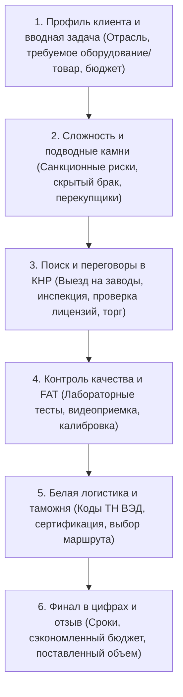

# Стандарты Контентной Фабрики Longwang.ru (E-E-A-T, Кейсы, Блог, GEO/AIO)

> [!NOTE]
> Документ консолидирует **Редакционный стандарт №1**, **Стандарт контента кейсов v2.0/v5.0 (Gemini)**, калиброванные промпты переписывания и требования к адаптации под генеративный ИИ-поиск (GEO / AIO) на 2026 год.

---

## 1. Единая идеология и голос бренда (Brand Voice & Tone)

Все материалы сайта (коммерческие страницы, кейсы, статьи блога) создаются по единому редакционному стандарту:
- **Тон:** спокойный, экспертный, уверенный, прагматичный, без инфоцыганщины и маркетинговых штампов.
- **Главный посыл:** *«Мы не посредники и не байеры с рынков Иу — мы лицензированные агенты клиента внутри китайской юрисдикции, защищающие финансовые и юридические интересы российского бизнеса»*.
- **Факты вместо самовосхваления:**  
  ❌ Запрещено: «Мы лидеры рынка», «У нас лучшая команда», «Быстро и дешево».  
  ✔️ Разрешено: «Собственный склад консолидации 1200 м² в Фошане», «Оплата через шанхайские финансовые шлюзы в юанях», «Выездная инспекция по чек-листу из 42 параметров перед отгрузкой».

---

## 2. Стандарт B2B-кейса (`/projects/`) — Версия v2.0 / v5.0

Кейс на Longwang.ru — это не рекламный отзыв, а **производственно-логистический детектив** со счастливым концом.  
Кейс демонстрирует реальную экспертность и квалификацию команды для поисковых систем (E-E-A-T) и ЛПР (директоров по закупкам, собственников бизнеса).

### Обязательная структура кейса:

### Жесткие ограничения кейсов (Strict Constraints):
1. **Защита от каннибализации коммерческих услуг:**  
   Кейс описывает *конкретный случай*, но не оптимизируется под общие высокочастотные запросы услуг (например, заголовок кейса: *«Поставка 4-зонной муфельной печи 1600°C для завода огнеупоров в Челябинске»*, а НЕ *«Купить печь из Китая»*).
2. **Контентные ссылки:**  
   Внутри каждого кейса ставятся 2–3 естественные ссылки:
   - На родительскую услугу доставки или ВЭД;
   - На страницу категории оборудования или бренда.
3. **Реальные технические параметры:**  
   Точные марки стали, мощности в кВт, классы точности, габариты в мм, температурные диапазоны (°C).

---

## 3. Стандарт Экспертной Статьи Блога (`/useful-articles/`)

Цель статьи — захват информационного поискового спроса на этапе формирования потребности, формирование авторитета и бесшовный перевод читателя в коммерческую воронку.

### Вечные правила контура для экспертных статей (Strict Editorial Invariants):
1. **Объем материала (Volume Guard):**
   * Объем экспертной статьи — **строго не менее 1600 слов** полезного фактоидного текста (без учета технического кода, стилей и системных тегов). Поверхностные короткие заметки категорически запрещены.
2. **Многоуровневое семантическое ядро (1-, 2-, 3-словные ключи с точным вхождением):**
   * Ядро статьи формируется из трех уровней запросов:
     * *Однословные базовые маркеры* (например: «импорт», «пошлины», «оборудование», «арматура», «растаможка»);
     * *Двухсловные ключи* (например: «пошлины еэк», «белый импорт», «запорная арматура», «расчет ндс»);
     * *Трехсловные целевые связки* (например: «повышение ввозных пошлин», «оборудование из китая», «система спот фнс», «контракт вэд китай»).
   * Точные вхождения обязаны присутствовать как в реестре ядра, так и непосредственно в тексте (H1, H2, H3, лид-абзац, таблицы) с соблюдением естественной плотности (тошнота по ключевым фразам не выше 3–4%).
3. **Внутренняя контекстная перелинковка (Relative Links Guard):**
   * В теле каждой статьи размещается **не менее 4–6 относительных ссылок** (`/supplies-services-china/...`, `/projects/...`) на смежные услуги и реальные кейсы поставок:
     * Хаб промышленного оборудования: `/supplies-services-china/equipment-from-china/`
     * Аудит и выездная проверка фабрик: `/supplies-services-china/proverka-postavshhika-v-kitae/`
     * Инспекция качества и контроль отгрузки: `/supplies-services-china/goods-check-china/`
     * Параллельный импорт и контрактный ВЭД: `/supplies-services-china/parallelnyj-import-is-kitaya/`
     * Профильные кейсы из раздела `/projects/`
4. **Сдержанный экспертный стиль без маркетинговых клише (Zero Cliche Guard):**
   * Полный запрет на кричащие маркеры, кислотные плашки и дешевые призывы («шок», «внимание», «сенсация», «только сегодня», «уникальное предложение»).
   * Подача выдерживается в строгом, академическом B2B-стиле (уровень отраслевого аналитического бюллетеня или РБК Pro): спокойный тон, уважительное обращение, точные цифры, ссылки на нормативные акты.
5. **Фактоидная аргументация:**
   * Практические нюансы работы с фабриками провинций Гуандун, Чжэцзян, Шаньдун.
   * Сравнительные таблицы (`<table>`) с расчетом пошлин и НДС 22%.
   * Бесшовный CTA на расчет белой себестоимости и аудит контракта.
6. **Запрет публикации служебных таблиц ядра (No Internal Specs in Public HTML):**
   * Служебные таблицы семантического ядра (1-, 2-, 3-словники, интенты, ТЗ) ведутся строго во внутренней аналитической документации (Markdown-файлы проекта).
   * **КАТЕГОРИЧЕСКИ ЗАПРЕЩЕНО** размещать реестры ядра в видимом теле HTML-статьи. Это засоряет частотный словарь страницы мусорными маркерами («1-словник», «2-словник»), накручивает паразитную тошноту и ломает верстку.

---

## 4. Требования к ИИ-поиску (GEO / Generative Engine Optimization & AIO)

Поисковые системы в 2026 году (Яндекс Нейро, Google AI Overviews, Perplexity) извлекают фрагменты текста для формирования прямого ответа пользователю.

### Правила оптимизации под ИИ и защита от Zero-Click:
1. **Защита кликабельности и теги ограничения сниппетов (AI Click-Through & Snippet Guard):**
   * Чтобы поисковые нейросети не «высасывали» весь объем статьи в нулевой ответ (Zero-Click), лишая сайт трафика, а отдавали краткий тезис со ссылкой на первоисточник:
     * В мета-тегах страницы прописывается директива: `<meta name="robots" content="max-snippet:150, max-image-preview:large, max-video-preview:-1">` (ограничение длины цитаты поисковым роботом до 150 символов);
     * Для глубоких таблиц расчетов, детальных калькуляций и инструкций используется атрибут `data-nosnippet`, стимулирующий пользователя перейти по ссылке на сайт Longwang.ru для полного ознакомления с расчетами.
2. **Q&A блоки и прямые дефиниции:**  
   В начале каждого смыслового блока давать ответ в 1–2 предложениях прямо по существу вопроса без метафор.
3. **Табличные сущности:** ИИ-модели отдают наивысший приоритет данным, оформленным в виде таблиц `<table>` с четкими заголовками колонок.
4. **Schema.org разметка:**
   - `FAQPage` (для блоков вопросов и ответов);
   - `Product` / `Service` (для страниц оборудования и услуг);
   - `Article` (для блога).
5. **КРИТИЧЕСКИЙ ЗАПРЕТ ТОКСИЧНЫХ СЛОВ:**  
   КАТЕГОРИЧЕСКИ ЗАПРЕЩЕНО использовать формулировки *«в обход санкций»*, *«серые схемы»*, *«двойное назначение»*.  
   Использовать СТРОГО: *«параллельный импорт оригинальной продукции в соответствии с ПП РФ № 506»*, *«поставка промышленного оборудования от OEM-производителей»*, *«белое таможенное оформление»*.

---

## 5. Библиотека канонических промптов

### 5.1. Боевой промпт генерации HTML-страниц услуг (ChatGPT v5.0)
Используется для создания готовых HTML-блоков коммерческих услуг:
- **Роль:** SEO-специалист, B2B-копирайтер и маркетолог Longwang.ru.
- **Ориентиры качества:** соотношение text/html > 25%, водность < 15%, классическая тошнота < 15, полное отсутствие шаблонных водянистых фраз.
- **Обязательные блоки:** Hero (оффер + CTA), Преимущества с цифрами, Этапы работы (5–8 шагов), Калькулятор/Таблица тарифов, Блок рисков и их решения, Документы/Сертификаты, FAQ (5–7 вопросов с ответами), Форма заявки.

### 5.2. Промпт для брендовых страниц (Atlas Copco, Bitzer, DeepSeek)
Используется для генерации посадочных страниц брендов:
- **Изоляция контента:** Каждая страница бренда обязана содержать уникальные таблицы артикулов, отраслевые примеры применения, отличия оригинальных серий от аналогов.
- **Перелинковка:** С брендовой страницы обязательно вести ссылку на хаб [Параллельный импорт](/supplies-services-china/parallelnyj-import-is-kitaya/) и на смежные узлы (например, с компрессоров Bitzer — на [Термооборудование](/supplies-services-china/equipment-from-china/thermo-equipment-china/)).

### 5.3. Стандарты On-Page и валидации SiteAnalyzer (Strict Quality Gate)
- **Title (строго 55–65 символов):** `[Главный ключ]: [УТП / Конкретика с цифрами] | Long Wang`. Обрезка поисковиками недопустима.
- **H1 (строго 55–65 символов):** Емкий, предметный заголовок без водянистых придаточных предложений (до 60–65 знаков).
- **Description (строго 150–160 символов):** `[Суть решения и нормативная база]. Калькуляция с НДС 22%, риски и прямой контракт ВЭД под ключ.`
- **Соотношение Text/HTML (строго > 25%):** Категорически запрещено перегружать каждую ячейку `<td>` тяжелыми inline-стилями `style="..."`. Стилизация таблиц и карточек оформляется через компактный тег `<style>` в шапке статьи.
- **Академическая тошнота (строго <= 15,0):** Контроль частотности биграмм и триграмм. Запрещены механические повторы громоздких дат («до 30 сентября 2027 г.» заменяется на «до 30.09.2027»). Повторы главных сущностей (НДС, пошлины, ВЭД) разбавляются предметными синонимами (фискальная нагрузка, тарифная ставка, таможенные сборы).
- **Водность текста (строго < 15,0%):** Полное отсутствие канцеляризмов и вводных конструкций-паразитов.
