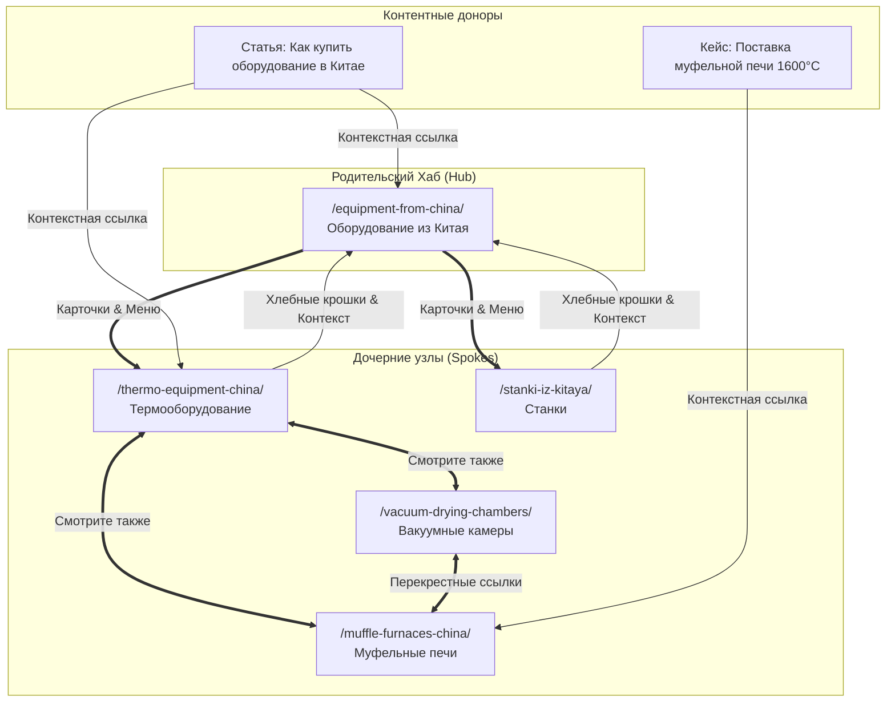

# Анализ Внутренней Перелинковки Longwang.ru (на основе Screaming Frog / GoW Project)

> [!NOTE]
> Документ основан на комплексном аудите выгрузки Screaming Frog (179 целевых URL, 1425 возможностей перелинковки, 62 дочерних связи) из файла [internal_linking_report.xlsx](file:///C:/Codex/projects/GoW%20Project/internal_linking_report.xlsx).

---

## 1. Сводка текущего состояния ссылочного графа

| Метрика | Значение | Статус | Комментарий |
|---|---|---|---|
| **Всего индексируемых целевых URL** | 179 | В норме | Включает хабы, услуги, бренды, печи, статьи, кейсы. |
| **Битые внутренние ссылки (на 301 редиректы)** | 6 | ⚠️ Требует исправления | Ссылки в статьях ведут на промежуточные редиректы. |
| **Выявленные возможности перелинковки** | 1 425 | ⚡ Точка роста | Статьи блога и новости не ссылаются на коммерческие хабы. |
| **Дочерние узлы с дефицитом входящих связей** | 10 (печи) | ⚠️ P0 Архитектура | Дочерние страницы печей изолированы от родительского хаба оборудования. |
| **Проблемы каннибализации в краулере** | 0 прямых дублей | В норме | Дублирование предотвращено на уровне шаблонов. |

---

## 2. Критические ошибки: Внутренние ссылки на редиректы (Redirect Fixes)

В контенте блога обнаружены внутренние гиперссылки, ведущие не на канонический адрес, а на промежуточный 301-редирект. Это расходует краулинговый бюджет и замедляет индексацию:

| Страница-донор | Куда ведет ссылка сейчас (301) | Канонический целевой URL | Тип ссылки | Действие |
|---|---|---|---|---|
| `.../posledniye-novosti-iz-kitaya/page/4/` | `.../useful-articles/kak-dostavit-gruz-iz-kitaya-samoletom/` | `.../useful-articles/aviadostavka-gruzov-iz-kitaya/` | Content | **Заменить URL в тексте** |
| `.../posledniye-novosti-iz-kitaya/page/4/` | `.../useful-articles/slozhnosti-aviadostavki-iz-kitaya/` | `.../useful-articles/aviadostavka-gruzov-iz-kitaya/` | Content | **Заменить URL в тексте** |
| `.../useful-articles/biznes-s-kitaem-s-nulya.../` | `.../useful-articles/slozhnosti-aviadostavki-iz-kitaya/` | `.../useful-articles/aviadostavka-gruzov-iz-kitaya/` | Navigation | **Заменить в навигации** |
| `.../useful-articles/page/4/` | `.../useful-articles/kak-dostavit-gruz-iz-kitaya-samoletom/` | `.../useful-articles/aviadostavka-gruzov-iz-kitaya/` | Content | **Заменить URL в тексте** |
| `.../useful-articles/page/4/` | `.../useful-articles/slozhnosti-aviadostavki-iz-kitaya/` | `.../useful-articles/aviadostavka-gruzov-iz-kitaya/` | Content | **Заменить URL в тексте** |
| `.../useful-articles/stoimost-dostavki-iz-kitaya/` | `.../useful-articles/kak-dostavit-gruz-iz-kitaya-samoletom/` | `.../useful-articles/aviadostavka-gruzov-iz-kitaya/` | Navigation | **Заменить в навигации** |

---

## 3. Архитектурный дефицит: Изоляция дочерних страниц печей

Краулер выявил, что родительский коммерческий хаб `/supplies-services-china/equipment-from-china/` имеет **0 прямых контентных ссылок** на специализированные транзакционные страницы печей:
- `/chamber-furnaces-china/` (Камерные печи)
- `/drying-cabinets-china/` (Сушильные шкафы)
- `/drying-cultivation-cabinets/` (Комбинированные шкафы)
- `/muffle-furnaces-china/` (Муфельные печи)
- `/specialized-industrial-furnaces/` (Специализированные печи)
- `/tubular-compact-furnaces/` (Трубчатые компактные печи)
- `/tubular-furnaces-china/` (Многозонные трубчатые печи)
- `/vacuum-drying-chambers/` (Вакуумные сушильные камеры)
- `/vacuum-soldering-furnaces/` (Вакуумные печи для пайки)
- `/water-baths-thermostats/` (Водяные бани и термостаты)

> [!WARNING]
> Сейчас пользователь и робот могут попасть на них только через субхаб `/thermo-equipment-china/`. Это создает 4-й уровень вложенности кликов.
> **Решение (P0):** Внедрить на хабе `/equipment-from-china/` интерактивный блок/плитку популярных категорий оборудования со ссылками на ключевые печи и камеры!

---

## 4. Схема Hub-and-Spoke для Longwang.ru

### Правила распределения анкоров:
1. **Точные коммерческие анкоры:**  
   Использовать строго из [Семантической матрицы v2.0](file:///C:/Codex/projects/SEO/docs/architecture/MASTER_ARCHITECTURE_V4.md):
   - На хаб оборудования: *«поставка оборудования из Китая»*, *«промышленное оборудование из КНР»*.
   - На термооборудование: *«термическое оборудование из Китая»*, *«промышленные печи и сушильные шкафы»*.
   - На муфельные печи: *«муфельные печи из Китая»*, *«печи для спекания керамики»*.
2. **Запрет безанкорных ссылок:**  
   Никаких «тут», «здесь», «по ссылке». Анкор обязан содержать целевую сущность и геопривязку (Китай/КНР).
