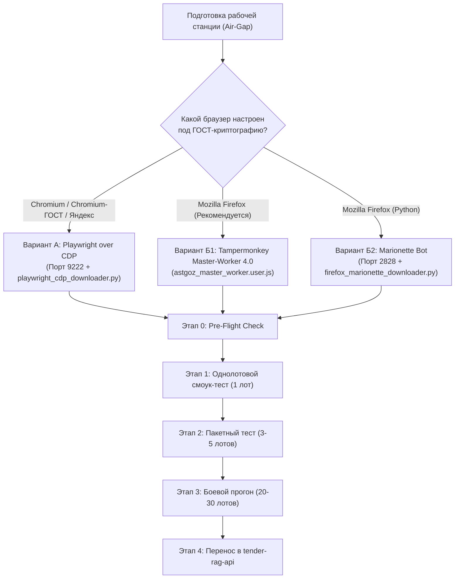

# План тестирования: Автоматизация выгрузки документации АСТ ГОЗ (223.astgoz.ru)

**Документ:** Программа и методика испытаний модуля выгрузки в изолированном контуре (Air-Gap)  
**Ответственный исполнитель:** Михаил Денисов (разработчик / тестирование на ГОЗ-станции)  
**Участники:** Артем (руководитель), Александра (валидация архивов), ИИ-ассистент (Antigravity)  
**Связанные модули:**
- ТЗ и ретроспектива: [`docs/mikhail_task_ast_goz_automation.md`](file:///Users/connect/Documents/tender-rag-api/docs/mikhail_task_ast_goz_automation.md)
- Руководство пользователя: [`scripts/ast_goz/README.md`](file:///Users/connect/Documents/tender-rag-api/scripts/ast_goz/README.md)
- Руководство и план для Александры: [`scripts/ast_goz/instruction_for_aleksandra.md`](file:///Users/connect/Documents/tender-rag-api/scripts/ast_goz/instruction_for_aleksandra.md)
- Версия Chromium (CDP): [`scripts/ast_goz/playwright_cdp_downloader.py`](file:///Users/connect/Documents/tender-rag-api/scripts/ast_goz/playwright_cdp_downloader.py)
- Версия Firefox (Tampermonkey): [`scripts/ast_goz/astgoz_master_worker.user.js`](file:///Users/connect/Documents/tender-rag-api/scripts/ast_goz/astgoz_master_worker.user.js)
- Версия Firefox (Marionette): [`scripts/ast_goz/firefox_marionette_downloader.py`](file:///Users/connect/Documents/tender-rag-api/scripts/ast_goz/firefox_marionette_downloader.py)
- Каскадный конвейер приема: [`docs/part2_regulatory_sieve/test_data/Итог/cascade_testing_plan.md`](file:///Users/connect/Documents/tender-rag-api/docs/part2_regulatory_sieve/test_data/Итог/cascade_testing_plan.md)

---

## 1. Контекст и цели тестирования

### 1.1. Специфика контура испытаний (Air-Gap / Спецсвязь)
* Рабочая станция подключена к сети **АСТ ГОЗ через программно-аппаратный криптошлюз (ViPNet Client / Континент АП)**.
* Во время активной сессии **публичный интернет и локальная сеть полностью заблокированы**.
* Аутентификация, вход в закрытую часть `223.astgoz.ru` и подписание запросов документации производятся через **локальный аппаратный токен ЭЦП (Рутокен/JaCarta) и плагин КриптоПро ЭЦП Browser plug-in**.

### 1.2. Цели испытаний
1. **Подтверждение стабильности реестра:** доказать, что автоматизация не уводит страницу реестра назад/вперед по истории (`history.back()`) и не сбрасывает выставленные оператором фильтры поиска лотов.
2. **Валидация сквозного скачивания:** подтвердить успешный переход по цепочке: *Строка реестра ➔ Запрос документации ➔ Чекбокс согласия ➔ Подписание ЭЦП КриптоПро ➔ Выгрузка ZIP-архива*.
3. **Проверка дедупликации:** убедиться, что повторный запуск скрипта не тратит время и ресурсы на повторное скачивание уже выгруженных лотов.
4. **Проверка статусной метки:** подтвердить автоматический вызов действия `action=set_documents` («Подготовить документы») и скрытие отработанных лотов по кнопке «Применить фильтры».
5. **Целостность данных:** проверить, что скачанные ZIP-архивы не имеют нулевого размера ($> 0$ байт) и успешно распаковываются для передачи в конвейер `tender-rag-api`.

---

## 2. Объекты и варианты тестирования

Тестирование проводится для двух ключевых сценариев в зависимости от используемого браузера на рабочей станции Михаила:



---

## 3. Программа и методика испытаний (Пошаговый регламент)

### Этап 0: Предварительная подготовка (Pre-Flight Check)
*Выполняется ДО включения изолированного режима ViPNet, пока доступен интернет или локальный дистрибутив.*

1. **Для Варианта А (Chromium CDP):**
   * Проверить версию Python: `python --version` (требуется Python 3.10+).
   * Проверить наличие библиотеки Playwright:
     ```cmd
     python -c "import playwright; print('Playwright OK')"
     ```
     *(Если не установлена: `pip install playwright`. Браузеры Playwright скачивать НЕ нужно).*
   * Создать рабочую директорию выгрузки на диске: `C:\AST_GOZ_DOCS`.
2. **Для Варианта Б1 (Firefox + Tampermonkey):**
   * Убедиться, что в Firefox установлено расширение Tampermonkey.
   * Создать новый скрипт в Tampermonkey и вставить код из [`scripts/ast_goz/astgoz_master_worker.user.js`](file:///Users/connect/Documents/tender-rag-api/scripts/ast_goz/astgoz_master_worker.user.js).
   * В настройках Firefox (`about:preferences` ➔ «Основные» ➔ «Файлы и приложения») переключить радиокнопку в режим: **«Всегда сохранять файлы в папку Загрузки»** (критично, чтобы браузер не блокировал поток диалоговым окном «Куда сохранить файл»).
3. **Проверка токена:**
   * Вставить аппаратный токен Рутокен/JaCarta в USB-порт;
   * Проверить работоспособность плагина КриптоПро в браузере (успешный тест на странице проверки плагина).

---

### Этап 1: Однолотовой смоук-тест (Single Lot Smoke Test)
*Цель: проверить прохождение полного цикла на одном лоте без риска зависания реестра.*

#### Порядок действий для Варианта А (Chromium CDP):
1. Запустить браузер с открытым отладочным портом:
   * Либо двойным кликом по [`scripts/ast_goz/run_astgoz_chromium.bat`](file:///Users/connect/Documents/tender-rag-api/scripts/ast_goz/run_astgoz_chromium.bat);
   * Либо вручную из командной строки:
     ```cmd
     chrome.exe --remote-debugging-port=9222 --user-data-dir="C:\astgoz_browser_profile"
     ```
2. Войти по сертификату в закрытую часть: `https://223.astgoz.ru`.
3. Открыть реестр лотов: `https://223.astgoz.ru/registry/view/pr_lots_all` и применить фильтр (например, поставить чекбокс «Интересно»).
4. Запустить робота на 1 процедуру:
   ```cmd
   python scripts/ast_goz/playwright_cdp_downloader.py --output-dir="C:/AST_GOZ_DOCS" --max-lots=1
   ```

#### Порядок действий для Варианта Б1 (Firefox Tampermonkey):
1. Открыть Firefox и зайти в реестр `https://223.astgoz.ru/registry/view/pr_lots_all`.
2. Убедиться, что в правом верхнем углу отобразилась панель управления: **🦊 AST-GOZ CONTROL 4.0**.
3. В строке таблицы первого интересного лота нажать кнопку **«▶ Выгрузить лот»** (точечная выгрузка).

#### Критерии успешности Этапа 1:
- [ ] Робот нашел строку лота и извлек его номер (например, `26...`);
- [ ] Открылась отдельная вкладка запроса документации, вкладка реестра осталась на месте;
- [ ] Чекбокс согласия автоматически выставился;
- [ ] Окно сертификата КриптоПро сработало и подписало запрос;
- [ ] На странице выгрузки автоматически нажалась ссылка «Выгрузить»;
- [ ] В папке назначения появился файл: `<Номер_Лота>.zip` с размером $> 0$ КБ;
- [ ] Архив успешно открывается архиватором 7-Zip/WinRAR и содержит файлы документации (ТЗ, проект договора);
- [ ] Вкладка запроса автоматически закрылась;
- [ ] В исходной строке реестра вызвано действие «Подготовить документы».

---

### Этап 2: Пакетный тест малой партии (Batch Test: 3–5 лотов)
*Цель: проверить работу очереди, циклическое переключение, дедупликацию и очистку памяти.*

#### Порядок действий:
1. Запустить скрипт с лимитом на 3–5 лотов:
   * **Chromium CDP:**
     ```cmd
     python scripts/ast_goz/playwright_cdp_downloader.py --output-dir="C:/AST_GOZ_DOCS" --max-lots=5
     ```
   * **Firefox Tampermonkey:** нажать зеленую кнопку **«🚀 ПОЛНЫЙ АВТОМАТ (Master-Worker)»** и после обработки 3 лотов нажать кнопку паузы/останова.
2. Сразу после завершения запустить команду повторно с теми же параметрами.

#### Критерии успешности Этапа 2:
- [ ] Все 3–5 лотов обработаны последовательно;
- [ ] Ни одна вкладка не зависла в открытом состоянии;
- [ ] Реестр не сбросился и не вернулся на первую страницу;
- [ ] При **повторном запуске** скрипт вывел в лог сообщение вида:
  `[СКИП] Архив уже скачан: C:/AST_GOZ_DOCS/26.../26....zip -> Пропуск`
  и завершился без повторных обращений к серверу.

---

### Этап 3: Боевой стресс-тест партии (Full Production Batch: 20–30 лотов)
*Цель: подтвердить автономность робота при реальной дневной норме выгрузки.*

#### Порядок действий:
1. Выставить боевые фильтры в реестре АСТ ГОЗ (актуальные закупки по интересующим отраслям).
2. Запустить полную выгрузку:
   ```cmd
   python scripts/ast_goz/playwright_cdp_downloader.py --output-dir="C:/AST_GOZ_DOCS" --max-lots=30 --delay=3
   ```
   *(или нажать «🚀 ПОЛНЫЙ АВТОМАТ» в Tampermonkey).*
3. Не вмешиваться в работу браузера в течение 10–15 минут.
4. По завершении зафиксировать статистику по логам.

#### Критерии успешности Этапа 3:
- [ ] Успешно выгружено не менее 95% лотов от общего количества целевых строк;
- [ ] Средняя скорость обработки: 15–30 секунд на один лот;
- [ ] В реестре автоматически нажата кнопка «Применить фильтры», и обработанные лоты скрылись из рабочего списка;
- [ ] Сводный объем папки `C:\AST_GOZ_DOCS` соответствует сумме скачанных архивов;
- [ ] Отсутствуют «битые» файлы с размером 0 КБ.

---

### Этап 4: Интеграция с конвейером `tender-rag-api`
*Цель: проверить совместимость скачанных архивов со скриптом каскадной сортировки.*

1. Скопировать выгруженную папку `C:\AST_GOZ_DOCS` (через флеш-накопитель или внутренний защищенный файловый шлюз) на аналитическую машину проекта.
2. Распаковать или переместить папки закупок во входящий каталог каскада:
   `01_stage1_inbox_national_regime/`
3. Запустить симуляцию каскадного конвейера:
   ```bash
   python3 scripts/batch_cascade_sorter.py --dry-run
   ```
4. Убедиться, что:
   - Имена файлов и папок корректно транслитерируются;
   - Парсер номенклатуры и нацрежима успешно читает DOCX/PDF/XLSX файлы из выгруженных архивов;
   - Сведения о закупке попадают в `cascade_tenders_registry.xlsx`.

---

## 4. Матрица рисков и устранение сбоев (Troubleshooting)

| Симптом сбоя | Возможная причина | Способ устранения |
|:---|:---|:---|
| **`ConnectionRefusedError: [WinError 10061]`** (CDP) | Браузер не запущен с флагом отладочного порта или порт 9222 занят | 1. Запустить `taskkill /f /im chrome.exe`.<br>2. Запустить браузер строго через `run_astgoz_chromium.bat`.<br>3. Проверить в браузере адрес `http://127.0.0.1:9222/json/version`. |
| **Окно «Сохранить как...» блокирует поток** (Firefox) | В настройках браузера включен запрос пути сохранения | Зайти в `about:preferences` ➔ «Основные» ➔ включить **«Всегда сохранять файлы в папку Загрузки»**. |
| **Таймаут ожидания модального окна КриптоПро** | Медленный отклик токена или защищенного канала ViPNet | Увеличить параметр задержки: `--delay=5` или в скрипте изменить `timeout=30000` (до 30 сек). |
| **Реестр теряет позицию / пустая страница** | Были использованы старые методы навигации (`history.back()`) | Убедиться, что используется версия скрипта **4.0** (CDP или Master-Worker), где вкладка реестра статична. |
| **Архив скачался с размером 0 КБ** | Обрыв сессии скачивания на стороне шлюза АСТ ГОЗ | Робот автоматически удаляет файлы 0 КБ. Повторный запуск скрипта перекачает данный лот. |

---

## 5. Протокол приемочных испытаний (Форма для заполнения Михаилом)

| Параметр проверки | Значение / Результат | Статус (Пройден / Сбой) |
|:---|:---|:---:|
| **Дата проведения тестирования** | *[Указать дату]* | — |
| **Используемый браузер** | *Chromium-ГОСТ / Яндекс / Firefox* | — |
| **Выбранный вариант инструмента** | *Playwright CDP / Tampermonkey 4.0* | — |
| **Результат Этапа 1 (1 лот)** | *Файл скачан, размер: ___ МБ* | ⬜ Pass / ⬜ Fail |
| **Результат Этапа 2 (3–5 лотов)** | *Обработано: ___ из ___, дедупликация сработала* | ⬜ Pass / ⬜ Fail |
| **Результат Этапа 3 (Партия 20–30 лотов)**| *Всего лотов: ___, успешно: ___, сбоев: ___* | ⬜ Pass / ⬜ Fail |
| **Среднее время на 1 закупку** | *___ секунд* | ⬜ Pass / ⬜ Fail |
| **Сохранность фильтров реестра** | *Фильтры не сбросились / сбросились* | ⬜ Pass / ⬜ Fail |
| **Совместимость с конвейером** | *Архивы распакованы и прочитаны парсером* | ⬜ Pass / ⬜ Fail |

### Итоговое заключение:
*Модуль автовыгрузки АСТ ГОЗ (версия CDP / Tampermonkey 4.0) признан пригодным к регулярной промышленной эксплуатации в изолированном контуре.*

**Подпись ответственного разработчика:** __________________ / Михаил Денисов /
